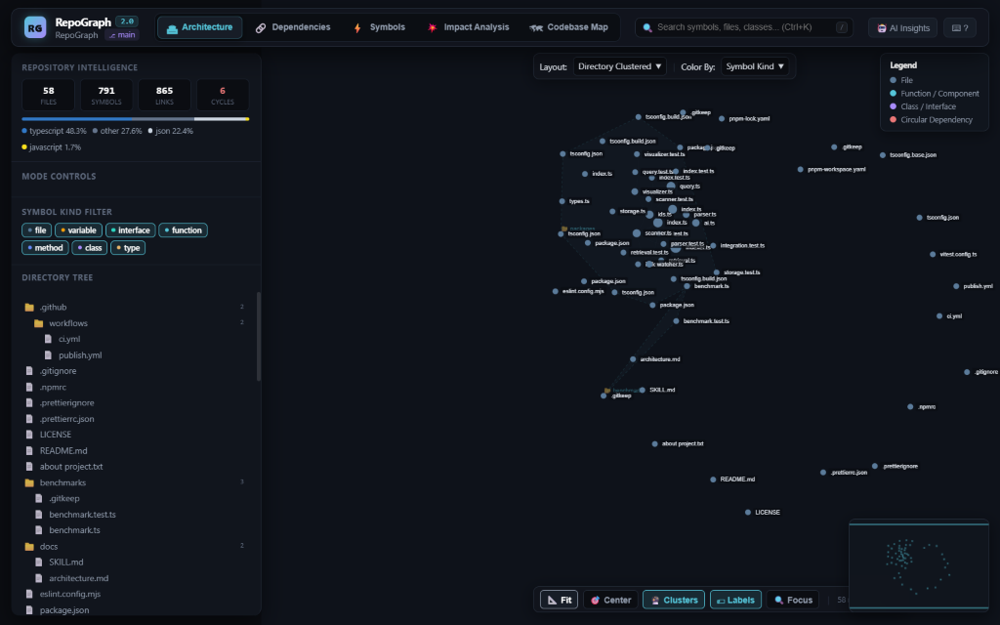
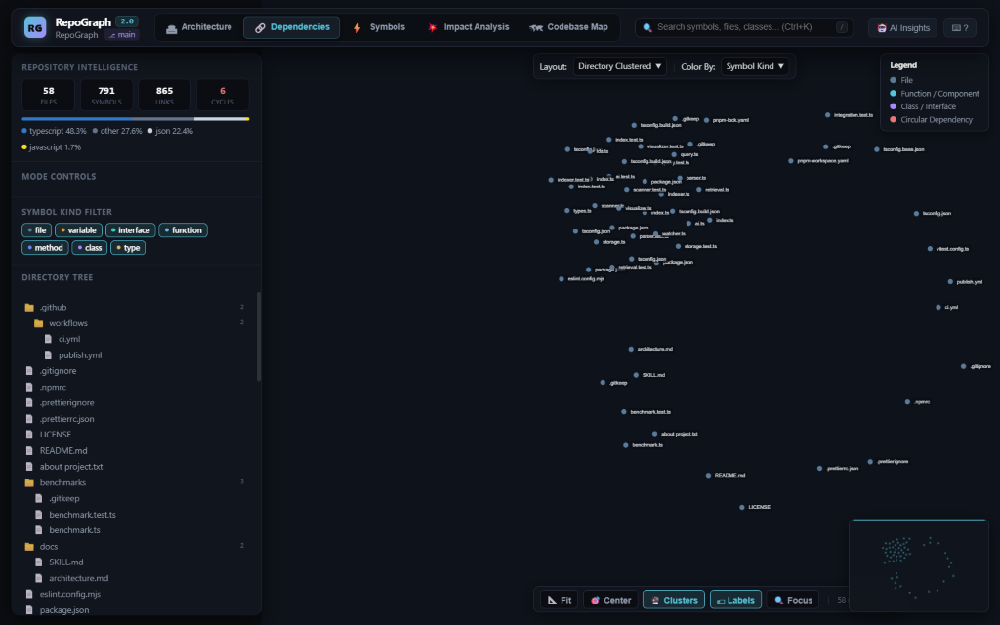
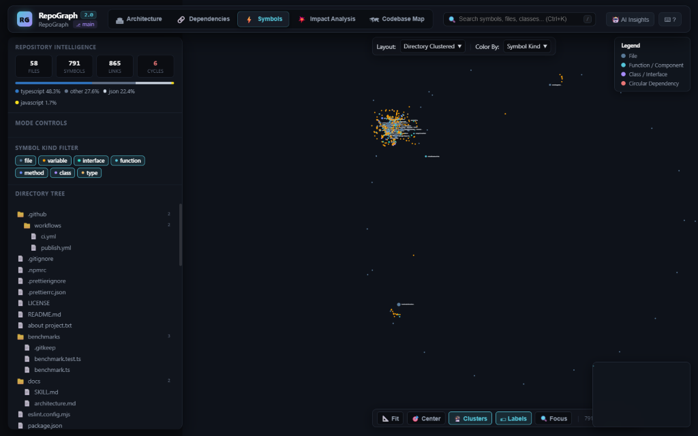
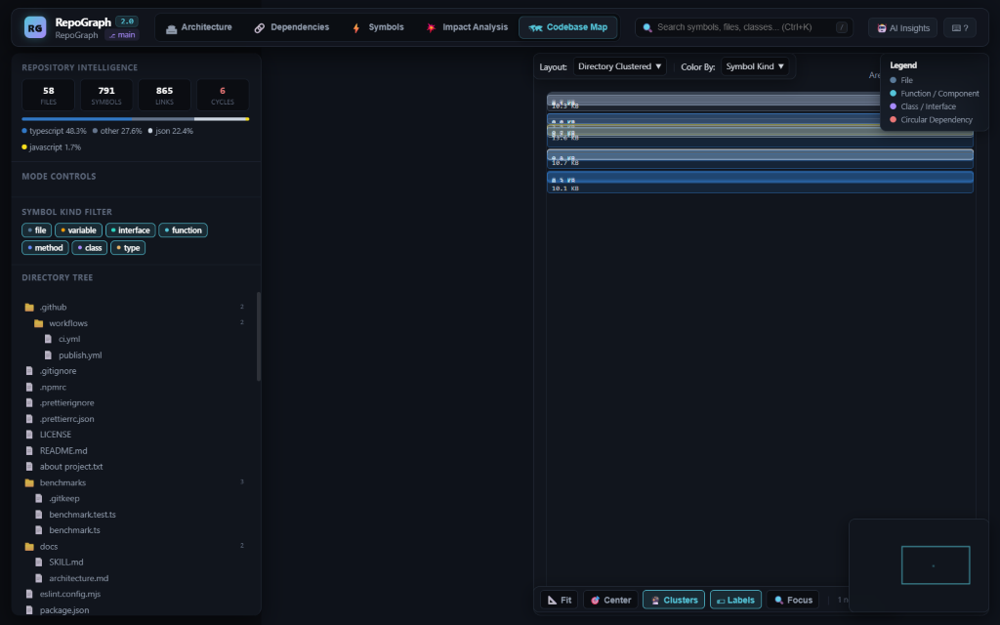
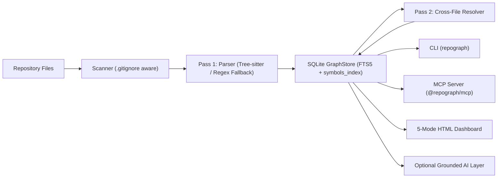

# RepoGraph 2.0 by aayanlabs

<div align="center">

[](https://github.com/aayanlabs/repograph/actions/workflows/ci.yml)
[](LICENSE)
[](https://nodejs.org/)
[](https://www.typescriptlang.org/)
[](https://github.com/aayanlabs/repograph)

**A local-first codebase intelligence platform for developers and AI coding agents.**

_Understand architecture · Trace dependencies · Analyze blast radius · Navigate unfamiliar codebases — all without cloud APIs._

</div>

**RepoGraph 2.0** is a local-first codebase intelligence platform and semantic code graph for developers and AI coding agents. It indexes software repositories into a versioned SQLite (`node:sqlite` + FTS5) graph with two-pass cross-file symbol resolution, module coupling metrics, blast-radius analysis, an interactive 5-mode graph dashboard, and an expanded Model Context Protocol (MCP) server.

> **Copyright (c) 2026 aayanlabs** — Released under the MIT License.

---

## Why RepoGraph?

Understanding large repositories shouldn't require grepping blindly or burning LLM context windows reading dozens of files:

- **Architectural Clarity**: Explore repository structure, directory clusters, dependency density, and circular imports visually.
- **Change Impact & Blast Radius**: Trace multi-hop downstream callers and importers with risk scoring before editing shared symbols.
- **Cross-File Symbol Resolution**: Two-pass indexing resolves named/default/namespace imports, cross-file function calls, and class/interface inheritance (`static` and `inferred` confidence).
- **Coupling & Technical Debt**: Compute fan-in, fan-out, and Martin instability index ($I = \text{FanOut} / (\text{FanIn} + \text{FanOut})$) across every module.
- **Zero-Cloud by Default**: Runs 100% locally with `node:sqlite`. External AI providers are completely optional and never receive source code unless explicitly configured.

---

## Quick Start

```bash
# Clone & build
git clone https://github.com/aayanlabs/repograph.git
cd repograph && pnpm install && pnpm build

# Index any repository
node packages/cli/dist/index.js init /path/to/your/project

# Launch the interactive 5-mode dashboard
node packages/cli/dist/index.js ui -p /path/to/your/project
# → Open http://localhost:3333

# Get an architecture overview from the CLI
node packages/cli/dist/index.js overview -p /path/to/your/project

# Check blast radius before editing a file
node packages/cli/dist/index.js impact src/core/auth.ts -p /path/to/your/project
```

---

## Five Graph Visualization Modes

Launch the self-contained dashboard with `repograph ui`:

1. **Architecture View (Default)** — Directory-clustered overview with collapsible folder filtering, convex cluster hulls, dependency density, and progressive disclosure.
2. **Dependency View** — Directional import/dependency graph highlighting incoming/outgoing relationships, circular dependency loops, and isolated/coupled modules.
3. **Symbol View** — Inspect functions, classes, methods, interfaces, types, and their call/inheritance/containment relationships.
4. **Impact Analysis View** — Select any file or symbol to visualize its multi-hop downstream blast radius, risk score, and affected files.
5. **Codebase Map** — Squarified treemap sized by file bytes and colored by language with click-to-drill navigation.

**Interactive Controls**:

- **3 Layout Algorithms**: Directory Clustered, Layered DAG, and Concentric Radial.
- **Instant Search Highlighting**: Press `/` or `Ctrl+K` to highlight matching nodes without rebuilding the graph.
- **Keyboard Shortcuts**: `1`–`5` switch modes, `F` fit to screen, `H` toggle cluster hulls, `L` toggle labels, `Esc` clear selection.
- **Contextual Inspector & Minimap**: View module metrics, incoming/outgoing edges, blast radius, and grounded AI insights.

### Screenshots

#### Architecture View



#### Dependency View



#### Symbol View & Codebase Map

| Symbol View                                           | Codebase Map                                                 |
| ----------------------------------------------------- | ------------------------------------------------------------ |
|  |  |

---

## Architecture



### Package Structure

```text
RepoGraph/
├── packages/
│   ├── core/         # Scanner, parser, 2-pass indexer, SQLite GraphStore, retrieval, AI, visualizer
│   ├── cli/          # Commander CLI (`repograph`)
│   └── mcp/          # Model Context Protocol (MCP) stdio server
├── docs/
│   ├── architecture.md
│   └── SKILL.md      # Agent skill instructions for AI coding assistants
├── benchmarks/       # Reproducible indexing & query benchmark suite
└── tests/            # Integration & cross-package test suite
```

---

## Prerequisites & Installation

- **Node.js**: `>= 22.5.0` (uses native `node:sqlite`)
- **pnpm**: `>= 10.0.0`

```bash
git clone https://github.com/aayanlabs/repograph.git
cd repograph
pnpm install
pnpm build
```

Optional global CLI link:

```bash
cd packages/cli
npm link
```

---

## CLI Usage & Commands

```bash
repograph <command> [options]
```

| Command            | Description                                                    | Example                              |
| ------------------ | -------------------------------------------------------------- | ------------------------------------ |
| `init [path]`      | Index a repository into `.repograph/graph.db`                  | `repograph init .`                   |
| `update [path]`    | Incrementally update index for modified files                  | `repograph update`                   |
| `status [path]`    | Display graph statistics (files, nodes, edges)                 | `repograph status`                   |
| `overview`         | Show architecture summary, cycle warnings, and coupled modules | `repograph overview`                 |
| `metrics [target]` | Show fan-in, fan-out, and Martin instability index per module  | `repograph metrics`                  |
| `search <query>`   | Search symbols by name, path, or signature using FTS5          | `repograph search UserService`       |
| `context <task>`   | Retrieve ranked code context for a coding task                 | `repograph context "fix login auth"` |
| `deps <target>`    | List direct outgoing dependencies                              | `repograph deps src/auth.ts`         |
| `impact <target>`  | List multi-hop downstream dependents                           | `repograph impact src/types.ts`      |
| `path <src> <dst>` | Find shortest call/import path between symbols or files        | `repograph path User Auth`           |
| `cycles`           | Find circular import loops across files                        | `repograph cycles`                   |
| `export [options]` | Export repository graph in JSON or GraphML format              | `repograph export --format graphml`  |
| `watch [path]`     | Watch directory and incrementally index on file save           | `repograph watch`                    |
| `ui [path]`        | Launch the 5-mode interactive graph dashboard                  | `repograph ui --port 3333`           |
| `ai <query>`       | Query the code graph using grounded natural language           | `repograph ai "find circular deps"`  |
| `mcp [path]`       | Start the MCP server over stdio for AI coding agents           | `repograph mcp`                      |

---

## Model Context Protocol (MCP) Integration

RepoGraph connects seamlessly with AI coding assistants (Claude Desktop, Antigravity, Cursor, Windsurf). See [docs/SKILL.md](docs/SKILL.md) for agent workflow guidance.

### MCP Configuration Example

```json
{
  "mcpServers": {
    "repograph": {
      "command": "node",
      "args": ["/path/to/repograph/packages/mcp/dist/index.js", "/path/to/your/project"]
    }
  }
}
```

### Exposed MCP Tools

| Tool                      | Description                                                            |
| ------------------------- | ---------------------------------------------------------------------- |
| `get_repository_overview` | High-level stats, language breakdown, cycles, and top coupled modules  |
| `explain_architecture`    | Grounded architectural summary from actual graph metrics               |
| `search_symbols`          | Search symbols by name, path, or signature with optional `kind` filter |
| `get_dependencies`        | Direct outgoing dependencies of a file or symbol                       |
| `get_dependents`          | Direct incoming dependents of a file or symbol                         |
| `get_file_relationships`  | Combined incoming, outgoing, and module metrics for a file             |
| `analyze_impact`          | Structured blast radius report with risk score and causal paths        |
| `get_relevant_context`    | Ranked code snippets and relationships for a task                      |
| `find_cycles`             | Detect circular dependency loops                                       |
| `get_module_metrics`      | Fan-in, fan-out, and instability metrics across modules                |

_Backward-compatible legacy aliases (`repo_search`, `repo_context`, `repo_symbol`, `repo_dependencies`, `repo_dependents`, `repo_impact`, `repo_path`, `repo_cycles`, `repo_export`) remain fully supported._

---

## Optional AI Configuration

By default, `createAiProvider()` uses `MockAiProvider` (100% offline, grounded in graph metrics and SQLite queries). To enable an external LLM provider with explicit consent, configure environment variables:

- **OpenAI-compatible**: `OPENAI_API_KEY` (optional `OPENAI_BASE_URL`, `OPENAI_MODEL`)
- **Anthropic-compatible**: `ANTHROPIC_API_KEY` (optional `ANTHROPIC_MODEL`)
- **Local Ollama**: `OLLAMA_HOST` (optional `OLLAMA_MODEL`)

---

## Performance Benchmarks

Measured on synthetic TypeScript repositories (Windows, Node.js v24.18.0, `node:sqlite`):

| Repository Size | Index Time | Search (`FTS5`) | Context Retrieval | Impact Traversal | Module Metrics |
| --------------- | ---------- | --------------- | ----------------- | ---------------- | -------------- |
| **100 files**   | 845 ms     | 0.54 ms         | 0.61 ms           | 0.13 ms          | 1.13 ms        |
| **1,000 files** | 13,512 ms  | 3.23 ms         | 2.07 ms           | 0.14 ms          | 11.81 ms       |

---

## Development & Testing

```bash
# Build all workspace packages
pnpm build

# Run full unit & integration test suite (12 files, 35 tests)
pnpm test

# Run TypeScript typechecking across monorepo
pnpm typecheck

# Run ESLint check (0 warnings allowed)
pnpm lint

# Run benchmark test
pnpm --filter benchmarks test
```

---

## Contributing

Contributions are welcome! See [CONTRIBUTING.md](CONTRIBUTING.md) for setup instructions.

Looking for a place to start? Check out the [Good First Issues](GOOD_FIRST_ISSUES.md) — well-scoped tasks for new contributors, including:

- 🦀 **Rust / Java / C# language support**
- 🔀 **`repograph diff` for PR impact checks**
- 🎨 **Dark/Light theme toggle**
- 📸 **Export dashboard as PNG**

---

## License & Copyright

**RepoGraph by aayanlabs** is licensed under the [MIT License](LICENSE).

Copyright (c) 2026 **aayanlabs** (`mdaayanmalik9291@gmail.com`).
